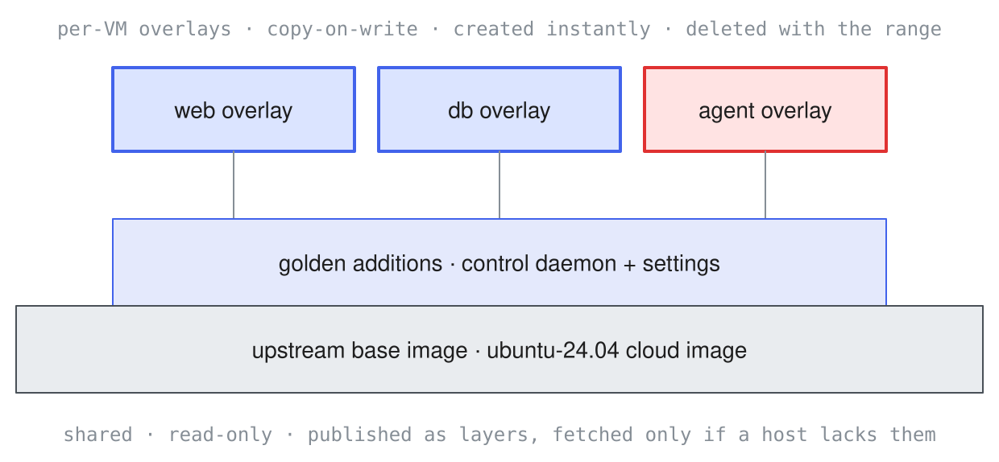

## Overview

Guests are the virtual machines in a range. They come in three kinds: hosts (the targets), routers (gateways between network segments), and the attacker. In a definition, "host" on its own always means a target, not the physical machine the range runs on. This page covers the guest half of a range definition. Network addressing, segmentation, and routing are covered in [Networks](networks.qmd).

Defining guests comes first ([hosts](#hosts), [images](#images), [resources](#resources), [routers](#routers-are-guests-too), [the attacker](#the-attacker-guest)), then [guest content](#guest-content) and the sections that produce and vary it, then [how configuration reaches a guest](#how-configuration-reaches-a-guest).

## Hosts {#hosts}

Hosts are the machines the attacker works against: web servers, databases, domain controllers, workstations. Each host entry declares the guest's identity (its name and, optionally, its in-guest hostname and FQDN), its operating system, the image it boots from, its CPU and memory, and the networks it attaches to. What runs on the host (accounts, services, weaknesses, data) is declared separately, under [Guest content](#guest-content).

This example defines a single host:

::: {.panel-tabset group="definition-language"}
### YAML

``` {.yaml .plan-invalid}
range:
  name: hosts
  description: Host identity fields and what consumes them.

networks:
  - name: corp
    cidr: 10.20.0.0/24
    mode: isolated

hosts:
  - name: dc01 # <1>
    hostname: dc01-nyc # <2>
    fqdn: dc01.corp.example # <3>
    os: { type: linux, distro: ubuntu-24.04 }
    image: acme/dc-golden
    resources: { cpus: 2, memory_mb: 4096 }
    interfaces: [{ network: corp, ip: 10.20.0.5 }]

attacker:
  interfaces: [{ network: corp }]
  entry: external
```

1.  The definition-wide identifier (exec targets, ACL endpoints).
2.  The in-guest hostname, when it differs from `name`.
3.  The fully qualified name, for ranges whose DNS serves it.

### Python

``` {.python .plan-invalid}
from inspect_ranges.types import (
    Attacker, Host, Interface, Network, Os, RangeMeta, RangeSpec,
    Resources,
)

hosts = RangeSpec(
    meta=RangeMeta(
        name="hosts",
        description="Host identity fields and what consumes them.",
    ),
    networks=[
        Network(name="corp", cidr="10.20.0.0/24", mode="isolated")
    ],
    hosts=[
        Host(
            name="dc01",  # <1>
            hostname="dc01-nyc",  # <2>
            fqdn="dc01.corp.example",  # <3>
            os=Os(type="linux", distro="ubuntu-24.04"),
            image="acme/dc-golden",
            resources=Resources(cpus=2, memory_mb=4096),
            interfaces=[Interface(network="corp", ip="10.20.0.5")],
        )
    ],
    attacker=Attacker(
        interfaces=[Interface(network="corp")], entry="external"
    ),
)
```

1.  The definition-wide identifier (exec targets, ACL endpoints).
2.  The in-guest hostname, when it differs from `name`.
3.  The fully qualified name, for ranges whose DNS serves it.
:::

Python definitions import from `inspect_ranges.types` (shown once above, later Python tabs omit it).

`name` is how everything else refers to the guest: `sandbox("dc01")` in evaluations, ACL endpoints, DNS `authoritative` lists. `hostname` is only needed when the in-guest name should differ, and `fqdn` matters for domain-joined ranges. `os` records the platform (`type: linux | windows`, with `distro` or `version` detail); `interfaces` are covered in [Networks](networks.qmd).

The in-guest hostname is the declared `hostname:` when one is present, else a hostname-safe form of `name`: invalid characters such as underscores and dots become hyphens, and Windows names truncate to the 15-character NetBIOS limit. Two guests whose rendered hostnames collide refuse at planning (`inspect-ranges plan` reports the collision as an error). `fqdn` is set at build time by the Active Directory recipes (promotion and domain join set the primary DNS suffix), so a range declaring it refuses to run until a build has produced that content and recorded it in the build manifest, the build's record of what it ran and produced (see [Building Ranges](building.qmd)).

`roles` tags a host's function, such as `roles: [domain-controller, dns]` or `[member-server]`. The tags tell the build what a host is for and give scoring a way to refer to hosts by function rather than by name. Roles take effect through the host's provisioning recipes at build time; a host declaring roles but no recipe refuses at planning (`realized-section-unconsumed`).

## Images {#images}

Every host names the `image` it boots from. Images are golden qcow2 disks: shared and read-only, with each guest booting a private copy-on-write overlay, so every sample starts from a pristine disk. A golden carries the baked-in control daemon (the in-guest service that runs commands, moves files, and answers readiness) plus whatever the scenario installed at build time. The definition references images by name; planning resolves each reference against the local image cache to a sha256 digest. How bare names resolve beyond the cache (pins, registries, the public catalog) is covered in [Images](images.qmd).

{fig-alt="The image layer stack: a shared read-only upstream base image at the bottom, a narrower golden-additions layer (control daemon and settings) on top of it, and small per-VM copy-on-write overlays for web, db, and agent fanning out above."}

An image reference missing from the cache shows up in the plan output and is an error at render:

```         
✗ range.yaml  1 error
  12:5  hosts[0].image  image 'acme/db-golden' for guest 'db' is
                        not in the image cache, so the bundle
                        cannot be self-sufficient (pull or build
                        the image into the cache)
```

## Resources {#resources}

Sizing is backend-neutral and optional:

::: {.panel-tabset group="definition-language"}
### YAML

``` {.yaml .fragment}
resources:
  cpus: 2
  memory_mb: 4096
  disk_gb: 20
```

### Python

``` {.python .fragment}
Resources(cpus=2, memory_mb=4096, disk_gb=20)
```
:::

Omitted resources resolve to 1 vCPU, 1024 MiB, and a 10 GiB overlay. `inspect-ranges plan` reports the range's totals (guests, vCPUs, memory) so a deployment can admission-check before anything boots.

## Routers {#routers-are-guests-too}

A router is an ordinary guest with one interface per joined segment, running a generated firewall that a defender inside the range can inspect. `os` and `image` are optional; when omitted, the backend's default router appliance is used:

::: {.panel-tabset group="definition-language"}
### YAML

``` yaml
range:
  name: router-guest
  description: >
    A router with explicit identity, and one with backend defaults.

networks:
  - name: dmz
    cidr: 10.80.10.0/24
    mode: isolated
  - name: internal
    cidr: 10.80.20.0/24
    mode: isolated

routers:
  - name: edge
    os: { type: linux, distro: ubuntu-24.04 }
    image: acme/router-golden
    resources: { cpus: 1, memory_mb: 512 }
    interfaces: [{ network: dmz }, { network: internal }]
    acl:
      - { from: dmz, to: internal, allow: [tcp/443] }

hosts:
  - name: app
    os: { type: linux }
    image: acme/app-golden
    interfaces: [{ network: internal }]

attacker:
  interfaces: [{ network: dmz }]
  entry: external
```

### Python

``` python
router_guest = RangeSpec(
    meta=RangeMeta(
        name="router-guest",
        description="A router with explicit identity, and one with "
        "backend defaults.",
    ),
    networks=[
        Network(name="dmz", cidr="10.80.10.0/24", mode="isolated"),
        Network(
            name="internal", cidr="10.80.20.0/24", mode="isolated"
        ),
    ],
    routers=[
        Router(
            name="edge",
            os=Os(type="linux", distro="ubuntu-24.04"),
            image="acme/router-golden",
            resources=Resources(cpus=1, memory_mb=512),
            interfaces=[
                Interface(network="dmz"),
                Interface(network="internal"),
            ],
            acl=[
                AclRule(from_="dmz", to="internal", allow=["tcp/443"])
            ],
        )
    ],
    hosts=[
        Host(
            name="app",
            os=Os(type="linux"),
            image="acme/app-golden",
            interfaces=[Interface(network="internal")],
        )
    ],
    attacker=Attacker(
        interfaces=[Interface(network="dmz")], entry="external"
    ),
)
```
:::

Policy (`acl`) and routing (`routes`, gateway election) are covered in [Networks](networks.qmd).

## Attacker {#the-attacker-guest}

The attacker is a guest like any other, declared separately because evaluations treat it specially (it is what `sandbox("default")` resolves to). It either boots as a dedicated attack box or starts from a foothold on a declared host. A dedicated attack box declares `interfaces`; `name` defaults to `attacker`, and omitting `image` selects the catalog's `attack`, a kali-class toolset image pulled automatically at eval init (see [Images](images.qmd)):

::: {.panel-tabset group="definition-language"}
### YAML

``` yaml
range:
  name: attack-box
  description: A dedicated attack box with explicit sizing.

networks:
  - name: dmz
    cidr: 10.80.10.0/24
    mode: isolated

hosts:
  - name: web
    os: { type: linux }
    image: acme/web-golden
    interfaces: [{ network: dmz }]

attacker:
  name: kali
  image: acme/kali-golden
  resources: { cpus: 2, memory_mb: 4096 }
  interfaces: [{ network: dmz }]
  entry: external
```

### Python

``` python
attack_box = RangeSpec(
    meta=RangeMeta(
        name="attack-box",
        description="A dedicated attack box with explicit sizing.",
    ),
    networks=[
        Network(name="dmz", cidr="10.80.10.0/24", mode="isolated")
    ],
    hosts=[
        Host(
            name="web",
            os=Os(type="linux"),
            image="acme/web-golden",
            interfaces=[Interface(network="dmz")],
        )
    ],
    attacker=Attacker(
        name="kali",
        image="acme/kali-golden",
        resources=Resources(cpus=2, memory_mb=4096),
        interfaces=[Interface(network="dmz")],
        entry="external",
    ),
)
```
:::

A dedicated attack box runs under Cloud Hypervisor by default, so the most adversarial guest gets the smaller VMM (unprivileged per-guest uid, seccomp, credential-checked hybrid vsock; see [Security](security.qmd#virtual-machine-monitors)). Declare `vmm: qemu` to keep QEMU; with `host:` set, the foothold host's own `vmm` applies. Hosts and routers default to QEMU and opt in per guest with `vmm: cloud-hypervisor`; a Cloud Hypervisor guest cannot yet carry [guest content](#guest-content) that requires a build; planning refuses the combination.

With `host:`, the attacker declares no machine of its own (the foothold is the machine), and `entry: assumed-breach` records the premise. The attacker's `egress` posture is covered in [Networks](networks.qmd#egress).

## Guest Content {#guest-content}

Beyond identity and sizing, a definition declares what a guest contains: accounts, services, seeded weaknesses, planted files, and protections. These declarations describe the converged state of a guest (what the guest looks like once fully set up), not boot-time actions. The build applies each declaration by whatever means the image demands (a provisioning recipe, content baked into a derived image, or a captured checkpoint) and verifies it before the range ships; the runtime never applies guest content per sample.

[`inspect-ranges build`](building.qmd) *realizes* every content section below except `scheduled_activity`: it applies the declarations to live guests, verifies them, and captures each guest's disk as a realized image. A range declaring content refuses planning (`range-not-built`) until a matching build exists; once one does, the range boots those captured images. `scheduled_activity` has no realizer yet and refuses at planning (`guest-config-not-realized`), so nothing boots with silently missing content.

## Users {#users}

`users` declares a guest's local accounts (routers can carry them too). Domain accounts belong in [`active_directory`](#active-directory), not here:

::: {.panel-tabset group="definition-language"}
### YAML

``` {.yaml .plan-invalid}
range:
  name: users
  description: Local accounts as converged state.
networks:
  - name: lab
    cidr: 10.10.10.0/24
    mode: isolated
hosts:
  - name: server
    os: { type: linux }
    image: acme/server-golden
    interfaces: [{ network: lab }]
    users:
      - { name: alice, password: bacon, note: "weak password" }
      - name: backup
        groups: [sudo]
        note: service account with sudo
attacker:
  interfaces: [{ network: lab }]
  entry: external
```

### Python

``` {.python .plan-invalid}
users = RangeSpec(
    meta=RangeMeta(
        name="users", description="Local accounts as converged state."
    ),
    networks=[
        Network(name="lab", cidr="10.10.10.0/24", mode="isolated")
    ],
    hosts=[
        Host(
            name="server",
            os=Os(type="linux"),
            image="acme/server-golden",
            interfaces=[Interface(network="lab")],
            users=[
                User(
                    name="alice",
                    password="bacon",
                    note="weak password",
                ),
                User(
                    name="backup",
                    groups=["sudo"],
                    note="service account with sudo",
                ),
            ],
        )
    ],
    attacker=Attacker(
        interfaces=[Interface(network="lab")], entry="external"
    ),
)
```
:::

## Services {#services}

`services` entries are assertions about the guest's converged listening surface, not an installation language. The build satisfies them (through a recipe, the image, or a checkpoint) and verifies them: the named service is listening on the declared port at the declared version. Installation itself belongs in [`provisioning`](#provisioning-references). The optional `package` names the dpkg package that embodies the service, for version attribution when the listening process cannot provide it (a PHP frontend served by apache attributes through `package: php7.4`, not the apache listener). The verification contract is in [Building Ranges](building.qmd#verification):

::: {.panel-tabset group="definition-language"}
### YAML

``` {.yaml .plan-invalid}
range:
  name: services
  description: >
    The converged listening surface, asserted and build-verified.
networks:
  - name: lab
    cidr: 10.10.10.0/24
    mode: isolated
hosts:
  - name: web
    os: { type: linux }
    image: acme/zabbix-golden
    interfaces: [{ network: lab }]
    services:
      - { name: zabbix-web, port: 80, version: 3.0.3 }
      - name: mysql
        port: 3306
        version: "5"
        credentials: { user: root, password: root }
attacker:
  interfaces: [{ network: lab }]
  entry: external
```

### Python

``` {.python .plan-invalid}
services = RangeSpec(
    meta=RangeMeta(
        name="services",
        description="The converged listening surface, asserted and "
        "build-verified.",
    ),
    networks=[
        Network(name="lab", cidr="10.10.10.0/24", mode="isolated")
    ],
    hosts=[
        Host(
            name="web",
            os=Os(type="linux"),
            image="acme/zabbix-golden",
            interfaces=[Interface(network="lab")],
            services=[
                Service(name="zabbix-web", port=80, version="3.0.3"),
                Service(
                    name="mysql",
                    port=3306,
                    version="5",
                    credentials=Credentials(
                        user="root", password="root"
                    ),
                ),
            ],
        )
    ],
    attacker=Attacker(
        interfaces=[Interface(network="lab")], entry="external"
    ),
)
```
:::

## Vulnerabilities and Misconfigurations {#vulnerabilities-and-misconfigurations}

The seeded attack surface is two distinct lists, because real intrusions lean heavily on misconfigurations. A vulnerability's `id` is a stable local name; `cve:` is an attribute when one applies, and `service:` ties the weakness to a declared service on the same host:

::: {.panel-tabset group="definition-language"}
### YAML

``` {.yaml .plan-invalid}
range:
  name: weaknesses
  description: >
    A CVE-backed vulnerability and a misconfiguration, as
    distinct lists.
networks:
  - name: lab
    cidr: 10.10.10.0/24
    mode: isolated
hosts:
  - name: web
    os: { type: linux }
    image: acme/zabbix-golden
    interfaces: [{ network: lab }]
    services:
      - { name: zabbix-web, port: 80, version: 3.0.3 }
    vulnerabilities:
      - id: zabbix-jsrpc-sqli
        cve: CVE-2016-10134
        service: zabbix-web
        description: >
          SQL injection in jsrpc.php, reachable unauthenticated.
    misconfigurations:
      - id: guest-login-enabled
        description: >
          The Zabbix guest account is enabled with an empty
          password.
attacker:
  interfaces: [{ network: lab }]
  entry: external
```

### Python

``` {.python .plan-invalid}
weaknesses = RangeSpec(
    meta=RangeMeta(
        name="weaknesses",
        description="A CVE-backed vulnerability and a "
        "misconfiguration, as distinct lists.",
    ),
    networks=[
        Network(name="lab", cidr="10.10.10.0/24", mode="isolated")
    ],
    hosts=[
        Host(
            name="web",
            os=Os(type="linux"),
            image="acme/zabbix-golden",
            interfaces=[Interface(network="lab")],
            services=[
                Service(name="zabbix-web", port=80, version="3.0.3")
            ],
            vulnerabilities=[
                Vulnerability(
                    id="zabbix-jsrpc-sqli",
                    cve="CVE-2016-10134",
                    service="zabbix-web",
                    description="SQL injection in jsrpc.php, "
                    "reachable unauthenticated.",
                )
            ],
            misconfigurations=[
                Misconfiguration(
                    id="guest-login-enabled",
                    description="The Zabbix guest account is enabled "
                    "with an empty password.",
                )
            ],
        )
    ],
    attacker=Attacker(
        interfaces=[Interface(network="lab")], entry="external"
    ),
)
```
:::

## Planted Data {#planted-data}

`data` declares scenario files: targets worth finding or exfiltrating, supporting material, captures. Flags never appear here; the per-sample secrets belong to [challenges](challenges.qmd):

::: {.panel-tabset group="definition-language"}
### YAML

``` {.yaml .plan-invalid}
range:
  name: planted-data
  description: Scenario files on a database host.
networks:
  - name: internal
    cidr: 10.20.0.0/24
    mode: isolated
hosts:
  - name: db
    os: { type: linux }
    image: acme/db-golden
    interfaces: [{ network: internal }]
    data:
      - path: /srv/data/customers.db
        description: the exfiltration target
        sensitive: true
      - path: /home/trainee/traffic.pcap
        description: packet capture with planted attack traffic
attacker:
  interfaces: [{ network: internal }]
  entry: assumed-breach
```

### Python

``` {.python .plan-invalid}
planted_data = RangeSpec(
    meta=RangeMeta(
        name="planted-data",
        description="Scenario files on a database host.",
    ),
    networks=[
        Network(name="internal", cidr="10.20.0.0/24", mode="isolated")
    ],
    hosts=[
        Host(
            name="db",
            os=Os(type="linux"),
            image="acme/db-golden",
            interfaces=[Interface(network="internal")],
            data=[
                DataFile(
                    path="/srv/data/customers.db",
                    description="the exfiltration target",
                    sensitive=True,
                ),
                DataFile(
                    path="/home/trainee/traffic.pcap",
                    description="packet capture with planted attack "
                    "traffic",
                ),
            ],
        )
    ],
    attacker=Attacker(
        interfaces=[Interface(network="internal")],
        entry="assumed-breach",
    ),
)
```
:::

## Defense {#defense}

The range-level `defense` section records the defensive posture on the D0 (no defenders) to D5 (adaptive defender) spectrum, with telemetry flows where signals are recorded or forwarded. A posture realizes through its telemetry flows, so a tier declared without `telemetry` entries refuses at planning; omitting `defense` already means D0. Per-host toggles turn individual protections on or off:

::: {.panel-tabset group="definition-language"}
### YAML

``` {.yaml .plan-invalid}
range:
  name: defended
  description: Passive detection, with per-host protection toggles.
networks:
  - name: lab
    cidr: 10.10.10.0/24
    mode: isolated
defense:
  tier: D2
  description: >
    Endpoint telemetry is recorded and searchable, no blocking
    response.
  telemetry:
    - { source: win, collector: Sysmon/WinEventLog, sink: splunk }
hosts:
  - name: splunk
    os: { type: linux }
    image: acme/splunk-golden
    interfaces: [{ network: lab }]
  - name: win
    os: { type: windows, version: server-2022 }
    image: windows-2022
    interfaces: [{ network: lab }]
    defense: { defender: true, firewall: false }
attacker:
  interfaces: [{ network: lab }]
  entry: external
```

### Python

``` {.python .plan-invalid}
defended = RangeSpec(
    meta=RangeMeta(
        name="defended",
        description="Passive detection, with per-host protection "
        "toggles.",
    ),
    networks=[
        Network(name="lab", cidr="10.10.10.0/24", mode="isolated")
    ],
    defense=Defense(
        tier="D2",
        description="Endpoint telemetry is recorded and searchable, "
        "no blocking response.",
        telemetry=[
            Telemetry(
                source="win",
                collector="Sysmon/WinEventLog",
                sink="splunk",
            )
        ],
    ),
    hosts=[
        Host(
            name="splunk",
            os=Os(type="linux"),
            image="acme/splunk-golden",
            interfaces=[Interface(network="lab")],
        ),
        Host(
            name="win",
            os=Os(type="windows", version="server-2022"),
            image="windows-2022",
            interfaces=[Interface(network="lab")],
            defense=HostDefense(defender=True, firewall=False),
        ),
    ],
    attacker=Attacker(
        interfaces=[Interface(network="lab")], entry="external"
    ),
)
```
:::

## Active Directory {#active-directory}

Identity is range-scoped (accounts exist in the domain, not on a host), so `active_directory` is a top-level section: the forest, its domains, each domain's controller (a declared host), accounts of note with groups and SPNs, and the seeded ACL-abuse chain as typed edges (each edge names a principal, a right, and a target):

::: {.panel-tabset group="definition-language"}
### YAML

``` {.yaml .plan-invalid}
range:
  name: forest
  description: >
    A parent and child domain with seeded identity attack surface.
networks:
  - name: corp
    cidr: 10.20.0.0/24
    mode: isolated
active_directory:
  forest: corp.example
  domains:
    - name: corp.example
      netbios: CORP
      dc: dc01
      users:
        - name: c.lannister
          password: il0vejaime
          groups: [Domain Admins]
      acls:
        - principal: t.lannister
          right: ForceChangePassword
          target: j.lannister
        - principal: j.lannister
          right: GenericWrite
          target: j.baratheon
    - name: north.corp.example
      netbios: NORTH
      dc: dc02
      parent: corp.example
      users:
        - name: sql_svc
          password: TrustN0one
          spns: [MSSQLSvc/db.north.corp.example:1433]
          note: kerberoastable
hosts:
  - name: dc01
    os: { type: windows, version: server-2022 }
    image: windows-2022
    interfaces: [{ network: corp, ip: 10.20.0.5 }]
  - name: dc02
    os: { type: windows, version: server-2022 }
    image: windows-2022
    interfaces: [{ network: corp, ip: 10.20.0.6 }]
attacker:
  interfaces: [{ network: corp }]
  entry: assumed-breach
```

### Python

``` {.python .plan-invalid}
forest = RangeSpec(
    meta=RangeMeta(
        name="forest",
        description="A parent and child domain with seeded identity "
        "attack surface.",
    ),
    networks=[
        Network(name="corp", cidr="10.20.0.0/24", mode="isolated")
    ],
    active_directory=ActiveDirectory(
        forest="corp.example",
        domains=[
            AdDomain(
                name="corp.example",
                netbios="CORP",
                dc="dc01",
                users=[
                    AdUser(
                        name="c.lannister",
                        password="il0vejaime",
                        groups=["Domain Admins"],
                    )
                ],
                acls=[
                    AdAcl(
                        principal="t.lannister",
                        right="ForceChangePassword",
                        target="j.lannister",
                    ),
                    AdAcl(
                        principal="j.lannister",
                        right="GenericWrite",
                        target="j.baratheon",
                    ),
                ],
            ),
            AdDomain(
                name="north.corp.example",
                netbios="NORTH",
                dc="dc02",
                parent="corp.example",
                users=[
                    AdUser(
                        name="sql_svc",
                        password="TrustN0one",
                        spns=["MSSQLSvc/db.north.corp.example:1433"],
                        note="kerberoastable",
                    )
                ],
            ),
        ],
    ),
    hosts=[
        Host(
            name="dc01",
            os=Os(type="windows", version="server-2022"),
            image="windows-2022",
            interfaces=[Interface(network="corp", ip="10.20.0.5")],
        ),
        Host(
            name="dc02",
            os=Os(type="windows", version="server-2022"),
            image="windows-2022",
            interfaces=[Interface(network="corp", ip="10.20.0.6")],
        ),
    ],
    attacker=Attacker(
        interfaces=[Interface(network="corp")], entry="assumed-breach"
    ),
)
```
:::

ACL edge rights use the vocabulary observed in real ranges (`GenericAll`, `GenericWrite`, `WriteDacl`, `WriteOwner`, `ForceChangePassword`, `SelfMembership`, `AddMember`); principals and targets are names as AD knows them (users, groups, OUs, or computer objects). The shipped [goad-light](examples/goad-light.md) example is the built exemplar: one forest, two domains, three Windows Server guests, and a seeded ACL-abuse chain to Domain Admin.

## Provisioning References {#provisioning-references}

Everything above declares state; `provisioning` names the build-time work that produces it when the image alone does not. Steps reference recipes by name and version, in order. The recipe language itself is deliberately outside the definition: recipes run once at range build, their versions land in the build manifest, and the runtime never runs them (authoring guide: [Building Ranges](building.qmd#authoring-recipes)):

::: {.panel-tabset group="definition-language"}
### YAML

``` {.yaml .plan-invalid}
range:
  name: provisioned
  description: A build recipe referenced by name, with inputs.
networks:
  - name: lab
    cidr: 10.10.10.0/24
    mode: isolated
hosts:
  - name: endpoint
    os: { type: linux }
    image: acme/endpoint-golden
    interfaces: [{ network: lab }]
    provisioning:
      - recipe: acme.telemetry_stack
        version: "2.1"
        vars: { splunk_ip: "10.10.10.10" }
attacker:
  interfaces: [{ network: lab }]
  entry: external
```

### Python

``` {.python .plan-invalid}
provisioned = RangeSpec(
    meta=RangeMeta(
        name="provisioned",
        description="A build recipe referenced by name, with inputs.",
    ),
    networks=[
        Network(name="lab", cidr="10.10.10.0/24", mode="isolated")
    ],
    hosts=[
        Host(
            name="endpoint",
            os=Os(type="linux"),
            image="acme/endpoint-golden",
            interfaces=[Interface(network="lab")],
            provisioning=[
                ProvisioningStep(
                    recipe="acme.telemetry_stack",
                    version="2.1",
                    vars={"splunk_ip": "10.10.10.10"},
                )
            ],
        )
    ],
    attacker=Attacker(
        interfaces=[Interface(network="lab")], entry="external"
    ),
)
```
:::

## Scheduled Activity {#scheduled-activity}

`scheduled_activity` declares recurring in-guest behavior simulation: bot scripts and scheduled tasks that create the user and defender activity real tradecraft depends on (and the token-theft surface scheduled tasks bring with them):

::: {.panel-tabset group="definition-language"}
### YAML

``` {.yaml .plan-invalid}
range:
  name: activity
  description: Behavior simulation on a domain controller.
networks:
  - name: corp
    cidr: 10.20.0.0/24
    mode: isolated
hosts:
  - name: dc01
    os: { type: windows, version: server-2022 }
    image: windows-2022
    interfaces: [{ network: corp }]
    scheduled_activity:
      - { script: responder.ps1 }
      - script: rdp_scheduler.ps1
        user: admin.user
        note: creates a stealable session
attacker:
  interfaces: [{ network: corp }]
  entry: assumed-breach
```

### Python

``` {.python .plan-invalid}
activity = RangeSpec(
    meta=RangeMeta(
        name="activity",
        description="Behavior simulation on a domain controller.",
    ),
    networks=[
        Network(name="corp", cidr="10.20.0.0/24", mode="isolated")
    ],
    hosts=[
        Host(
            name="dc01",
            os=Os(type="windows", version="server-2022"),
            image="windows-2022",
            interfaces=[Interface(network="corp")],
            scheduled_activity=[
                ScheduledActivity(script="responder.ps1"),
                ScheduledActivity(
                    script="rdp_scheduler.ps1",
                    user="admin.user",
                    note="creates a stealable session",
                ),
            ],
        )
    ],
    attacker=Attacker(
        interfaces=[Interface(network="corp")], entry="assumed-breach"
    ),
)
```
:::

## Variables {#variables}

`variables` declares per-instance values: things that should differ between generated instances of the same range, like randomized ports, passwords, and flag hints. Every variable requires a `default`, and definitions reference variables as `{{name}}` in YAML scalars. Loading substitutes the defaults before validation, so a whole-scalar reference keeps the variable's type (`port: "{{telnet_port}}"` validates as an integer) and embedded references interpolate as text. In Python the template is a function whose parameters play the role of the references, called with drawn values to produce a concrete spec:

::: {.panel-tabset group="definition-language"}
### YAML

``` {.yaml .plan-invalid}
range:
  name: randomized
  description: A randomized service port and a templated credential.
variables:
  telnet_port: { type: port, min: 1500, default: 2323 }
  admin_password: { type: password, default: "changeme123!" }
networks:
  - name: lab
    cidr: 10.10.10.0/24
    mode: isolated
hosts:
  - name: server
    os: { type: linux }
    image: acme/server-golden
    interfaces: [{ network: lab }]
    users:
      - { name: admin, password: "{{admin_password}}" }
    services:
      - { name: telnetd, port: "{{telnet_port}}" }
attacker:
  interfaces: [{ network: lab }]
  entry: external
```

### Python

``` {.python .plan-invalid}
def randomized(
    telnet_port: int = 2323, admin_password: str = "changeme123!"
) -> RangeSpec:
    return RangeSpec(
        meta=RangeMeta(
            name="randomized",
            description="A randomized service port and a templated "
            "credential.",
        ),
        variables={
            "telnet_port": Variable(
                type="port", min=1500, default=2323
            ),
            "admin_password": Variable(
                type="password", default="changeme123!"
            ),
        },
        networks=[
            Network(name="lab", cidr="10.10.10.0/24", mode="isolated")
        ],
        hosts=[
            Host(
                name="server",
                os=Os(type="linux"),
                image="acme/server-golden",
                interfaces=[Interface(network="lab")],
                users=[User(name="admin", password=admin_password)],
                services=[Service(name="telnetd", port=telnet_port)],
            )
        ],
        attacker=Attacker(
            interfaces=[Interface(network="lab")], entry="external"
        ),
    )


spec = randomized()
```
:::

## Guest Configuration {#how-configuration-reaches-a-guest}

The range compiler (the plan and render steps) emits each guest's desired configuration (addressing, resolvers, hostname, the router's firewall); how it reaches the guest is a per-image capability. Linux guests inject over cloud-init (a seed presented as a read-only virtio disk). Windows hosts inject over a per-boot unattend seed: a read-only cdrom whose answer file drives the sysprep'd golden's specialize pass (hostname, MAC-keyed static addressing, resolvers), with readiness announced by the in-guest control daemon. Windows routers are not yet realized and refuse at planning. An attack box is Linux by construction (the `attacker:` block declares no `os` field). A Windows host declaring `vmm: cloud-hypervisor` refuses at planning, since the seed rides removable media that Cloud Hypervisor cannot present. Other injectors are designed but not yet implemented: configuration baked at build time for images without an agent, DHCP-only for unmodifiable appliances, and pre-configured checkpoints.

::: {.panel-tabset group="definition-language"}
### YAML

``` yaml
range:
  name: windows-host
  description: >
    A Windows target on a locally installed golden (windows-ad-v1).
networks:
  - name: corp
    cidr: 10.20.0.0/24
    mode: isolated
hosts:
  - name: dc01
    os: { type: windows, version: server-2022 }
    image: windows-2022
    interfaces: [{ network: corp }]
attacker:
  interfaces: [{ network: corp }]
  entry: external
```

### Python

``` python
windows_host = RangeSpec(
    meta=RangeMeta(
        name="windows-host",
        description="A Windows target on a locally installed golden "
        "(windows-ad-v1).",
    ),
    networks=[
        Network(name="corp", cidr="10.20.0.0/24", mode="isolated")
    ],
    hosts=[
        Host(
            name="dc01",
            os=Os(type="windows", version="server-2022"),
            image="windows-2022",
            interfaces=[Interface(network="corp")],
        )
    ],
    attacker=Attacker(
        interfaces=[Interface(network="corp")], entry="external"
    ),
)
```
:::