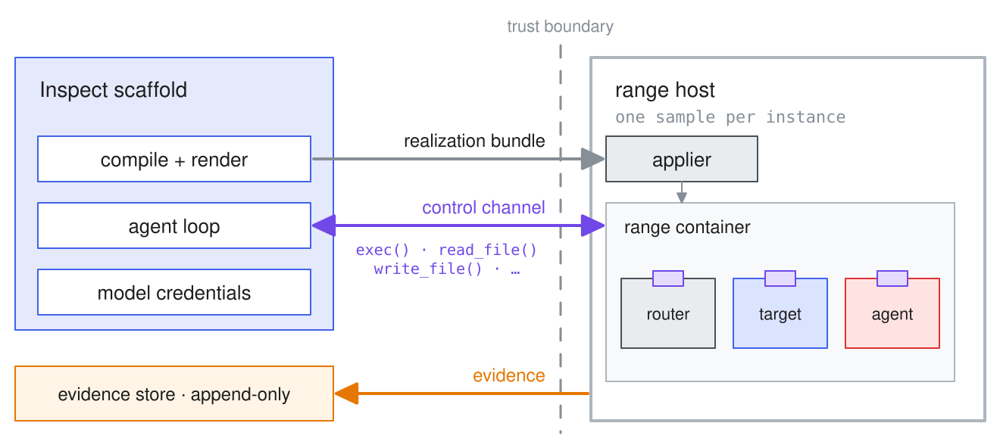

## Backends

The provider realizes ranges through the backend `INSPECT_RANGES_HOST` selects: two built-ins, or a custom backend the variable's own value registers ([Implementing a Host Provider](#implementing-a-host-provider)):

- **`local`** (the default): the co-resident path. The driver (the Inspect eval process that owns the sample) renders the realization bundle (the digest-manifested directory `render` emits; see [Operations](cli.qmd)) and runs realization in-process; guests are reached directly over vsock. The only addition over a plain setup is the host lease every sample holds (below).
- **`uds:<socket>`**: the separated topology on one host. A standing `inspect-ranges applier` process owns realization and teardown; the driver talks to it over a unix socket, and every guest operation relays through the same socket as an opaque byte stream. The driver still renders bundles (the compiler toolchain is driver-side) and still leases vsock CIDs (context ids); the applier verifies the bundle digest and runs `up`.
- **`<module>.<factory>[:<config>]`**: a registered backend. The dotted path names a factory from the `inspect_ranges.host` extension point, imported and called at resolution; the text after the first colon is the backend's own config ([Registering a Backend](#registering-a-backend)).

{fig-alt="The deployment seam: the Inspect scaffold (compile and render, agent loop, model credentials) and an append-only evidence store on the left, the range host with its applier and range container on the right, separated by a dashed trust boundary crossed by three flows: the realization bundle going in, the control channel (exec, read_file, write_file) in both directions, and evidence streaming out."}

``` {.bash .fragment}
# terminal 1: the applier (one per host; refuses unhealthy hosts)
inspect-ranges applier --socket /run/user/1000/ir-applier.sock

# terminal 2: evals through it
INSPECT_RANGES_HOST=uds:/run/user/1000/ir-applier.sock \
  inspect eval my_task.py
```

Both backends behave identically at the eval surface: same sandboxes, same ops, same cleanup semantics. The separated topology isolates the process that parses attacker-influenced bytes from the process holding credentials ([Security](security.qmd#topologies-and-credentials) covers when to prefer it). On one host it buys crash independence (a dead driver no longer strands cleanup knowledge in a dead process) and is the step toward multi-host dispatch.

Keep socket paths short: `AF_UNIX` paths cap at about 107 bytes, so prefer `/run/user/<uid>/...` or a short `/tmp` directory over deeply nested trees.

## Lease Contract {#the-lease-contract}

Every sample holds a **host lease**: an identity plus an absolute expiry, recorded in `leases.json` beside the CID registry under the shared state dir. The driver renews it at a third of the TTL (`INSPECT_RANGES_LEASE_TTL_S`, default 600 seconds); renewal is an on-disk compare-and-swap, so there is zero hot-path wire chatter. Release is destruction: a lease is removed only after a successful teardown, and a used host is never returned to a pool.

**The expiry-mid-sample policy: the reaper reclaims on expiry alone and never probes liveness.** A healthy sample never expires, because renewal is independent of sample activity; the only way to expire mid-sample is a dead or wedged driver, which is exactly what the reaper exists for. If a running sample's lease is reclaimed anyway (forced expiry, operator intervention), the driver fails the sample loudly with `LeaseLostError` at its next operation rather than letting it limp along on a reclaimed host. There is no looks-alive grace period; adding one would reintroduce the dependence on driver liveness that leases exist to remove.

## Operating the Reaper

`inspect-ranges reaper` is the independent cleanup process: fresh-process, on-disk only, never dependent on the original driver reaching its `finally`.

``` {.bash .fragment}
inspect-ranges reaper                # one sweep; exit 1 on failure
inspect-ranges reaper --interval 60  # daemon: sweep every minute
```

A sweep selects expired (and crashed-mid-reap) leases under the registry lock, re-checking expiry so a renewal that just landed spares its lease, and marks them `reaping`, which fails any further renewal. Teardown runs outside the lock. Only after a successful teardown does the sweep release the CID lease, clear staging and ownership records, and remove the host lease last. A failed teardown frees nothing: the lease stays findable and the next sweep retries.

Teardown dispatches on each lease's recorded origin (the `INSPECT_RANGES_HOST` value that minted it). `uds:` leases tear down through the applier socket (which also releases the resources the applier charged against the host at admission; see [Operating the Applier](#operating-the-applier)), falling back to direct teardown with a logged warning when the applier is unreachable; a registered backend's leases tear down through its own reclaim connector. An origin this machine cannot resolve (the backend's package is not installed here) deliberately reclaims nothing: a direct teardown against a host that lives elsewhere would "succeed" vacuously and release the lease over a still-running range, so the sweep reports `origin-unresolvable` and retries until the package is installed where the reaper runs.

`inspect-ranges doctor` reports lease health in its Host group, including an expired-leases hint that names the reaper.

## Operating the Applier

`inspect-ranges applier --socket <path> [--state-dir <dir>] [--image-cache <dir>]` serves two planes on one 0600 socket (same-uid trust): the host plane (realize, teardown, heartbeat) and a per-guest byte relay. It runs the doctor readiness subset at startup and refuses to serve an unhealthy host.

Realize is gated: the requested bundle digest must match the lease's rendered bundle (`EINVAL` otherwise), fetch grants must be empty (below), and the range's declared resources are charged against the applier's own admission gate, which refuses rather than queues: `EAGAIN` when the host is full right now (the driver respins), `ENOSPC` when the range alone exceeds the host (permanent). One realize per lease: a second realize on a live lease refuses `EBUSY` until teardown.

**Applier restart loses in-process state**: the replay log, guest relay map, and admission charges live in process memory and die with it (logged loudly at startup when live leases exist). Running samples keep their VMs; their teardowns recover from disk (the driver's teardown, the reaper, or `inspect sandbox cleanup range`), and new samples are served cleanly. When the applier is fully dead and a lease still exists, `inspect sandbox cleanup range` fails loudly by design (teardown for a leased project routes through the applier); recovery is reaper-only, via its direct-teardown fallback and the logged charge-leak warning.

## Grants Convention {#the-grants-convention}

`realize` carries a list of fetch grants for image delivery. Today the only supported delivery is **pre-seeded**: the image cache on the host already holds the verified golden chain, and the grants list must be empty. Pre-seeding is any of the [Images](images.qmd#deployment-shapes) recipes run on the host (`images pull`, a mirror, or a pin file) plus `inspect-ranges pull` for published range builds. A non-empty grants list refuses with `ENOTSUP` rather than silently ignoring it, so a deployment that expects granted-URL delivery fails at realize, not mid-boot. Granted-URL and registry delivery are the image-distribution growth path.

## Isolation Claim

Every lease records an isolation claim, and the provider logs it once per sample acquisition. Both built-in backends claim `isolation="shared"`: one host's kernel, device emulation, and caches are reused across samples, so a guest-to-host escape in one sample could reach another sample's resources. The claim labels the eval log honestly; it enforces nothing. `isolation="instance"` (a fresh host per sample) may be claimed only by a [registered backend](#registering-a-backend) that genuinely provides one.

## Implementing a Host Provider

Custom backends are a public extension point: the protocols live in [`inspect_ranges.host`](reference/host.qmd), and [registration](#registering-a-backend) is the environment variable itself. Both built-in backends implement one seam, two protocols:

- **`HostProvider`** acquires and releases range hosts. `acquire(sample, placement)` takes the sample's identity (`SampleSpec`: sample and task ids, the spec hash, the rendered bundle digest, declared resource totals) and the driver-side placement facts the lease record needs (`LeasePlacement`: project name, bundle path, staging, the evidence location), and returns a leased `RangeHost`. `release` destroys. `abandon` is the deliberate keep-it-running path (`cleanup=False`): renewal stops, the lease stays, and the reaper reclaims after expiry.
- **`RangeHost`** is one acquired host: the `RangeChannel` to it (the transport-agnostic control plane every guest operation rides; `None` between acquire and boot in the co-resident backend, which builds it from booted guest CIDs), the `isolation` claim, the deployment's declared `capabilities`, and its host-class `facts`. `check_lease()` raises `LeaseLostError` when the lease has been reclaimed, which is how lease loss fails a sample loudly at its next operation.

An implementation is held to the contracts this page already describes, plus three from the design record:

1. **Lease semantics.** `acquire` returns identity plus expiry; crashes, interrupted acquisition, partial boots, and network partitions are normal cases, not exceptions. Cleanup must be recoverable from recorded ownership by an independent process, never dependent on the original driver reaching its `finally`.
2. **Release is destruction.** A used host never returns to a pool, and under `isolation="instance"` release means the instance is destroyed or handed to independently controlled reprovisioning. The claim must be honest: it is logged per sample, and `"instance"` may be claimed only when the deployment actually provides a fresh host per sample.
3. **Capabilities refuse at planning.** `HostCapabilities` declares what the deployment can do (image delivery, upstream forwarding, egress grants, evidence delivery); a range whose requirements exceed the declaration refuses before anything boots, never degrades silently. No planner comparison exists yet (v1 pins every capability to its only supported value), so honor the gate by refusing in `acquire` when a range needs what your deployment cannot provide.

### Registering a Backend

The variable's value is the registration: any value that is neither `local` nor `uds:<socket>` is a dotted import path naming a factory, split at the first colon (so a config may itself contain colons). There is no registry call to make and no companion variable to keep in sync; the backend's package just has to be installed where evals, `doctor`, and the reaper run.

``` {.bash .fragment}
INSPECT_RANGES_HOST=mypkg.hosts.fleet:region-a \
  inspect eval my_task.py
```

The factory receives the verbatim value, the config, and the shared state dir, and returns the backend bundle:

``` {.python filename="mypkg/hosts.py"}
from inspect_ranges.host import (
    HostBackend,
    HostBackendContext,
    MessageChannel,
)


def fleet(ctx: HostBackendContext) -> HostBackend:
    """Factory: cheap, dials nothing (acquire does the work)."""
    return HostBackend(
        provider=FleetProvider(ctx.origin, ctx.config, ctx.state_dir),
        channel_for_lease=lambda lease: MessageChannel(
            FleetTransport(ctx.config, lease.lease_id),
            label=lease.project,
        ),
    )
```

`provider` is the `HostProvider`. `channel_for_lease` marks the backend separated: supply it and the runtime derives its boot, teardown, and per-guest channel seams from it, exactly how the `uds:` backend is built; leave it `None` for a co-resident backend that keeps the local realization path. A realistic separated backend implements one `Transport` (per-endpoint `connect`) and wraps it in `MessageChannel`, inheriting the whole wire discipline: request ids with idempotent resend, retries, the layered budgets, and strict validation of every reply as untrusted input. The optional `reclaim` overrides the reaper's teardown connector, and `doctor_probe` gives `inspect-ranges doctor` a reachability check.

Two requirements make crash recovery work:

- **Stamp the origin.** The provider must record `ctx.origin` verbatim as each lease's origin (`LeaseStore.acquire(origin=...)`). The value is the self-describing teardown address: a fresh process re-resolves it by import alone. Extra placement data (instance id, region) rides inside the config portion of the value.
- **Install the package where the reaper runs.** An origin the reaper cannot resolve reclaims nothing, per [the reaper's dispatch rule](#operating-the-reaper); `doctor` warns about lease origins its environment cannot resolve.

`doctor` resolves the variable the same way the provider will, so a typo'd or uninstalled backend fails the host checks instead of the eval (which otherwise refuses at startup, before anything renders or boots). The out-of-band oracle attach (`range_oracle`) remains local-only: it dials this machine's recorded guest sockets and refuses under any other backend. Entry-point scheme aliases (pretty names resolved from installed package metadata) are a compatible future addition; the dotted-path grammar stays.

What is not built yet, concretely: granted-URL and registry image delivery (`pre-seeded` is the only shape, per [the grants convention](#the-grants-convention)), `forward_upstream` and `egress_grant` capabilities (pinned `False`), and `isolation="instance"` in any built backend (a registered backend that genuinely provides a fresh host per sample may claim it). Evidence delivery has one built mode: the host writes to the per-sample location the driver hands it at acquire, through a put-only credential.

## Environment Vars

| Variable | Default | Effect |
|---|---|---|
| `INSPECT_RANGES_HOST` | `local` | Backend selection: `local` (co-resident), `uds:<socket>` (a running applier), or `<module>.<factory>[:<config>]` (a [registered backend](#registering-a-backend)). |
| `INSPECT_RANGES_LEASE_TTL_S` | 600 | Host lease TTL in seconds; the driver renews at TTL/3. A dead driver's sample becomes reclaimable one TTL after its last renewal. |
| `INSPECT_RANGES_HOST_CLASS` | `unspecified` | The host-class name recorded in lease host facts (declarations, never per-instance probes). |
| `INSPECT_RANGES_ATTACK_BOX` | unset | External [attack-box provider](attackbox.qmd#external-providers) registration (`<module>.<factory>[:<config>]`), consulted where realization runs: the driver under `local`, the applier's own environment under a separated backend. |

The provider's own knobs (concurrency, retries, image cache) are on the [Range Sandbox](provider.qmd) page and apply unchanged under either backend.
